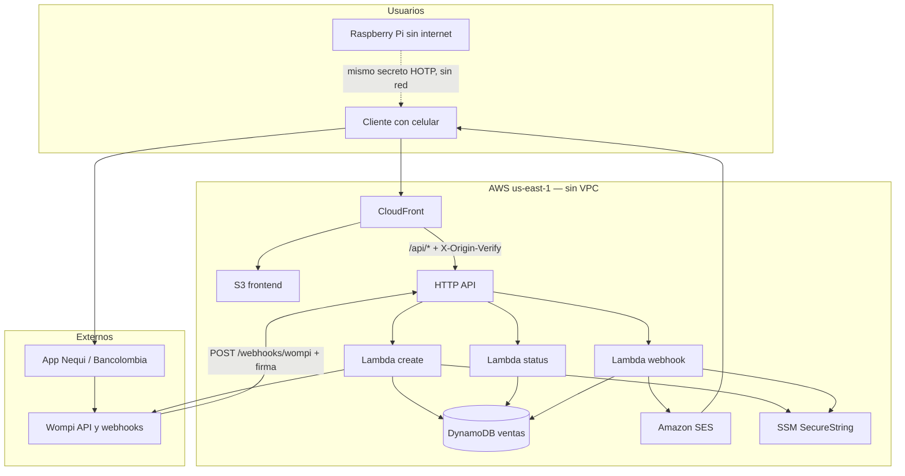
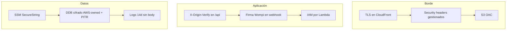

# 3. Arquitectura propuesta

Núcleo del diseño. La implementación está en [`infra/terraform`](../../infra/terraform).

## 3.1 Vista de contexto

No hay NAT, subnets, ALB ni RDS. Las Lambdas usan la conectividad de internet que AWS da a funciones **fuera de VPC**.

## 3.2 Flujo de datos (pago feliz)

1. El cliente abre `https://<cloudfront>/` e ingresa su correo.
2. CloudFront reenvía `POST /api/qr/crear` al HTTP API y añade `X-Origin-Verify`.
3. Lambda **create** lee secretos de SSM, pide tokens a Wompi, crea `BANCOLOMBIA_QR`, **persiste la venta PENDING + email** y espera el SVG del QR (hasta ~12 s). Convierte el SVG a PNG pixel-perfecto y lo devuelve una sola vez (el poll posterior no trae la imagen).
4. El cliente paga escaneando el QR (o “escanear desde imagen” en Nequi).
5. Wompi llama `POST /webhooks/wompi` **directo al API Gateway** (no pasa por CloudFront; Wompi no envía el header de origen).
6. Lambda **webhook** verifica SHA256 del evento, ignora métodos que no sean QR, y si `APPROVED`: incrementa el contador HOTP, guarda `code` + email, envía SES.
7. El frontend hace poll a `GET /api/qr/estado/{id}` (solo DynamoDB, ítem pequeño) hasta ver el código.
8. El cliente presenta el código en la Pi. `pi/hotp.py` debe coincidir con `src/hotp.js`.

## 3.3 Componentes de TI

| Capa | Servicio | Rol | Notas de costo |
|---|---|---|---|
| Edge | CloudFront | TLS, HTTP/2 y 3, Shield Standard, Price Class 200 (incluye Sudamérica) | Centavos a este tráfico |
| UI | S3 | `index.html`, `recibo.html`; público **nunca**; solo OAC | Casi $0 |
| API | API Gateway HTTP | Rutas `/api/*`, `/webhooks/wompi`, `/health`; throttle 50 rps / burst 100 | ~USD 0,85 al techo |
| Cómputo | Lambda × 3, `nodejs20.x`, **arm64** | create 256 MB / 20 s; status 128 MB / 5 s; webhook 256 MB / 15 s. **Sin reserved concurrency** (cuota de cuenta nueva = 10). | Always-free a este volumen |
| Datos | DynamoDB on-demand | Ventas, correo, estado, código, contador HOTP; 2 GSI; PITR | ~USD 0,35 |
| Correo | SES API v2 | From `pagos@techtest.app`; dominio DKIM/SPF; production access concedido | ~USD 1,50 / 15.000 mails |
| State IaC | S3 `wompi-qr-tfstate-<account>` | `prod/terraform.tfstate`, cifrado, versionado, **sin lock DynamoDB** | Centavos |
| Secretos | SSM Parameter Store SecureString | Llaves Wompi, HOTP, sender | $0 (Standard) |
| Observabilidad | CloudWatch Logs 14 d, alarmas Errors, Budget USD 10 | Sin body en access logs del API | ~USD 0,50 |
| Auditoría | CloudTrail multi-región, solo management events | Bucket dedicado, caduca a 90 días | Centavos |
| Notificaciones ops | SNS email | Budget, errores Lambda, bounce/complaint SES | $0 + confirmación de suscripción |

**Ausentes a propósito:** VPC, NAT, ALB, RDS, ElastiCache, WAF, Secrets Manager, KMS CMK, EC2, ECS, Step Functions.

## 3.4 Mapa de rutas y confianza

| Método | Ruta | Actor | Control de acceso |
|---|---|---|---|
| GET | `/` | Navegador | Público (HTML en CloudFront) |
| POST | `/api/qr/crear` | Navegador vía CloudFront | Header `X-Origin-Verify` |
| GET | `/api/qr/estado/{id}` | Navegador vía CloudFront | Header `X-Origin-Verify`; no reenvía el QR |
| POST | `/webhooks/wompi` | Wompi → execute-api | Firma SHA256 (`WOMPI_EVENTS_SECRET`) |
| GET | `/health` | Monitoreo | Público, sin PII |

## 3.5 Modelo de datos (DynamoDB)

Tabla `{project}-{env}-sales`, `PAY_PER_REQUEST`.

**Venta**

- `pk = SALE#{transactionId}`
- `sk = META`
- `customerEmail`, `amountInCents`, `reference`, `status`, `code` (solo si APPROVED), `counter`, `createdAt`, `paidAt`
- `gsi1pk = EMAIL#{email}` / `gsi1sk = TS#{createdAt}` — ventas de un correo
- `gsi2pk = DATE#{YYYY-MM-DD}` / `gsi2sk = SALE#{id}` — ventas del día

**Contador HOTP**

- `pk = COUNTER` / `sk = HOTP` / `value` (entero)
- Primer valor emitido = **0**, igual que el prototipo JSON (parte de -1 e incrementa). Crítico para no desfasar la Pi si se reutiliza el mismo secreto.

No hay TTL en ventas: el requisito de negocio es conservar el registro.

El PNG del QR **no** se persiste (evitar lecturas DynamoDB de ~50 KB en cada poll). Se genera en el `create` y vive en el navegador hasta el pago.

## 3.6 Capas de seguridad (vista)

## 3.7 Secretos (SSM)

Prefijo `/wompi-qr/{env}/`:

`wompi_base_url`, `wompi_public_key`, `wompi_private_key`, `wompi_integrity_secret`, `wompi_events_secret`, `hotp_secret`, `hotp_digits`, `ses_sender_email`, `amount_in_cents`, `ses_configuration_set`.

Las Lambdas **no** llevan secretos Wompi/HOTP en variables de entorno (sí el token de origen CloudFront, nombres de tabla/prefix y `SES_FROM_ADDRESS=pagos@techtest.app`, que no es secreto).

## 3.8 Código fuente de las funciones

Un solo artefacto zip (tres handlers) para no triplicar `pngjs` y el cliente Wompi:

| Función | Handler | Permisos destacados |
|---|---|---|
| create | `handlers/create-checkout.handler` | SSM, DynamoDB write, **sin SES** |
| status | `handlers/get-checkout.handler` | DynamoDB read, **sin SSM ni Wompi ni SES** |
| webhook | `handlers/webhook.handler` | SSM, DynamoDB, SES SendEmail |

Empaquetado: `infra/scripts/package-lambda.mjs` (copia `src/hotp.js`, `wompi.js`, `webhook-signature.js`, `qr-svg-to-png.js`).
