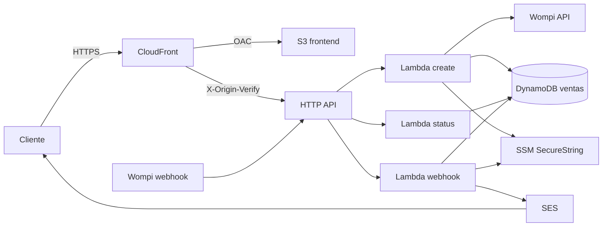

# Infraestructura serverless — Wompi QR

Documento de diseño (contexto, ADRs, costos, DRP): [`docs/diseno-infraestructura/`](../docs/diseno-infraestructura/README.md). Versión 0.2, desplegado.

## Qué no subir a git

| Nunca | Por qué |
|---|---|
| `.env`, `.env.*` (salvo `.env.example`) | Llaves Wompi, HOTP, Gmail, Twilio |
| `infra/terraform/terraform.tfvars` | Copia de esas llaves para el apply |
| `*.tfstate`, `.terraform/` | State con secretos SSM |
| `infra/.build/` | Zip de Lambda y `node_modules` |
| `data/`, `pi/secret.key`, `pi/state.json` | Códigos y secreto de la Pi |
| `tfplan` | Puede serializar valores sensibles |

Sí subir: `*.tf`, `*.tfvars.example`, `.terraform.lock.hcl`, `docs/`, `src/`, `infra/lambdas/` (sin `node_modules`).

Propuesta en Terraform del checkout QR + webhook + código HOTP + correo SES.
**Sin NAT Gateway, sin WhatsApp, sin VPC.** Las Lambdas corren fuera de VPC: salen a Wompi y SES por internet administrado de AWS (sin costo de NAT).

Región por defecto: **us-east-1** (N. Virginia).

## Arquitectura



Un solo hostname público (CloudFront) para el checkout. El webhook de Wompi usa la URL directa de API Gateway (Wompi no envía el header de origen).

| Recurso | Para qué |
|---|---|
| CloudFront + S3 | Página `/pagar-qr` y recibo. TLS incluido, Shield Standard gratis. |
| HTTP API | `POST /api/qr/crear`, `GET /api/qr/estado/{id}`, `POST /webhooks/wompi`, `GET /health`; throttle 50 rps |
| Lambda × 3 (arm64) | Crear QR, consultar estado (solo DynamoDB), procesar pago. Sin reserved concurrency: cuentas nuevas solo tienen cuota 10 y hay que dejar 10 unreserved. |
| DynamoDB on-demand | Venta + correo + estado + código + contador HOTP |
| SES | From `pagos@techtest.app`; dominio verificado; production access concedido |
| SSM Parameter Store | Secretos (SecureString, clave `aws/ssm`, sin Secrets Manager) |
| CloudTrail | Eventos de management (baseline, casi $0) |
| Budget | Alarma a USD 10 (los 2 primeros budgets son gratis) |

No hay VPC, NAT, WAF, Secrets Manager ni KMS customer-managed: todos suman costo fijo y no aportan a este volumen.

## Mapa de rutas

| Método | Ruta | Quién llama | Auth |
|---|---|---|---|
| GET | `/` | Navegador | Público (CloudFront) |
| POST | `/api/qr/crear` | Navegador vía CloudFront | Header `X-Origin-Verify` |
| GET | `/api/qr/estado/{id}` | Navegador vía CloudFront | Header `X-Origin-Verify` |
| POST | `/webhooks/wompi` | Wompi → API Gateway | Firma SHA256 de Wompi |
| GET | `/health` | Monitoreo | Público, sin PII |

## Datos por venta (DynamoDB)

- `pk = SALE#{transactionId}` / `sk = META`
- `customerEmail`, `amountInCents`, `reference`, `status`, `code` (solo APPROVED), `counter`, timestamps
- GSI `gsi1`: ventas por email
- GSI `gsi2`: ventas por día (`DATE#YYYY-MM-DD`)
- Ítem `COUNTER / HOTP`: contador atómico del HOTP (ADD)

PITR activado. No se borra con TTL: el requisito es registrar ventas.

## State remoto

Bucket `s3://wompi-qr-tfstate-660340274929` (us-east-1), key `prod/terraform.tfstate`, cifrado y versionado. **Sin tabla DynamoDB de locks** (un solo escritor). Se crea con `infra/scripts/bootstrap-state.sh`.

## Cómo aplicar

Requisitos: Terraform ≥ 1.5, AWS CLI, Node 20, cuenta con permisos de admin (o equivalentes de esta stack).

```bash
cd infra/terraform
cp terraform.tfvars.example terraform.tfvars   # editar secretos y correos
aws sts get-caller-identity
make -C .. init
make -C .. plan
make -C .. apply
```

Después del apply:

1. Confirmar la suscripción SNS que llega al correo de alarmas.
2. En SES, verificar el sender (link en el correo de AWS). Mientras SES esté en **sandbox**, solo se envía a direcciones verificadas. Pedir production access: SES → Account dashboard → Request production access.
3. Pegar `webhook_url` en Wompi → Desarrolladores → Eventos: `transaction.updated`.
4. Checkout: `cloudfront_url` (output).

## Seguridad (sin inflar costo)

- Lambdas **fuera de VPC** (no NAT).
- S3 bloqueado al público; CloudFront con Origin Access Control.
- Header compartido CloudFront → API para las rutas de browser; el webhook no lo usa.
- IAM por función (create no puede enviar correo; status no llama a Wompi ni SES).
- Secretos en SSM SecureString, no en env vars.
- TLS 1.2+ en CloudFront y origen API.
- Security headers gestionados de CloudFront.
- Throttle en API Gateway + reserved concurrency en Lambdas (techo de costo).
- Logs de API **sin body** (el email viaja en el POST).
- Retención de logs 14 días.
- DynamoDB cifrado con clave AWS (gratis) + PITR.
- Budget + alarmas de errores de Lambda.
- CloudTrail management events.

Lo que se dejó fuera a propósito: WAF (~USD 5+/mes), Secrets Manager (USD 0,40/secreto), CMK (USD 1/mes), GuardDuty, NAT (~USD 32/mes).

## Costos esperados

Al tope de 500 ventas/día: **~USD 3–6/mes** en us-east-1. Ver el canvas de estimación en el repo. El renglón más grande suele ser SES (~USD 1,50) y el poll de estado (API Gateway).

## WhatsApp (fase 2, no incluido)

Cuando exista WABA en AWS End User Messaging Social, se añade un publisher SNS/EventBridge desde el webhook. No forma parte de este stack.
